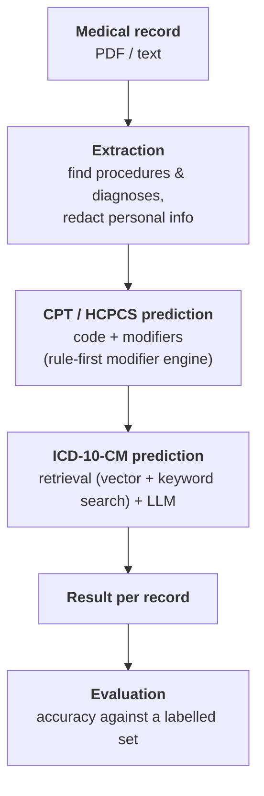

# Medical Coding AI

> LLM-powered system that turns clinical records into billing codes.

> **Note:** this repository contains documentation only — an overview and the workflow of the project. Source code and data are not included.

## Overview

Takes a clinical record (PDF or text) and produces the **CPT/HCPCS** procedure codes (with modifiers) and the **ICD-10-CM** diagnosis codes for it — redacting personal information along the way.

## Workflow

## How it works

1. **Extraction** — identifies the procedures and diagnoses in the record and redacts personal information.
2. **CPT/HCPCS prediction** — predicts the code for each procedure and the modifiers that apply, using a rule-first modifier engine.
3. **ICD-10-CM prediction** — finds the matching diagnosis code(s) using retrieval (vector + keyword search) combined with an LLM.
4. **Output and evaluation** — one result per record, with an evaluation step that measures accuracy against a labelled set.

## Highlights

- Built as independent services behind a single orchestrator.
- Personal information is redacted before coding.
- Rule-first modifier logic for CPT/HCPCS.
- Accuracy evaluated against a labelled dataset.

## Stack

Python · LLM agents · RAG · microservices · Docker · CI/CD

---

More projects: [github.com/ALIKAZMI001](https://github.com/ALIKAZMI001)
